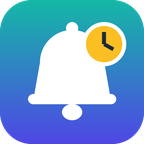

**Snooze: Issue Reminders & Follow-ups for Jira** puts reminders on Jira issues. They are sent only when they're still needed.

- **Follow-ups that cancel themselves:** "remind me on Friday, but only if nobody has touched the issue".
- **Due date reminders** that move when the due date changes.
- **Remind anyone:** yourself, the assignee, the reporter, the watchers, named people or Jira groups, once or on a schedule.
- **Runs on Atlassian:** your data never leaves Atlassian's platform.

## Support

Email **[getsnooze.support@gmail.com](mailto:getsnooze.support@gmail.com)**. We reply within 2 business days, Monday to Friday, 09:00–18:00 Lisbon time.

## Legal

- [Privacy Policy](privacy)
- [End User Terms](terms)
